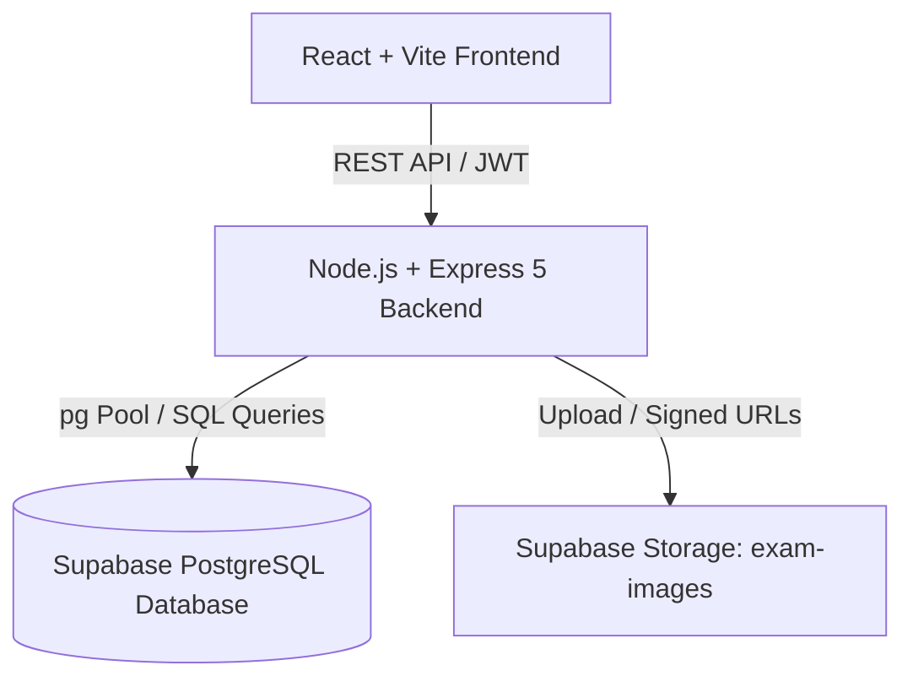

# TestBuddy 🎓

> A modern, lightweight, full-stack examination and assessment platform built with the PERN stack (PostgreSQL, Express 5, React, Node.js).

---

## 📖 Table of Contents

- [What is TestBuddy?](#what-is-testbuddy)
- [Why TestBuddy?](#why-testbuddy)
- [Key Features](#key-features)
  - [For Teachers & Educators](#for-teachers--educators)
  - [For Students & Candidates](#for-students--candidates)
  - [For Guests & Practice Takers](#for-guests--practice-takers)
- [Architecture & Tech Stack](#architecture--tech-stack)
- [Database Schema](#database-schema)
- [Getting Started](#getting-started)
  - [Prerequisites](#prerequisites)
  - [1. Clone Repository](#1-clone-repository)
  - [2. Backend Setup](#2-backend-setup)
  - [3. Frontend Setup](#3-frontend-setup)
  - [4. Database Migration](#4-database-migration)
- [API Reference](#api-reference)
- [Design Philosophy](#design-philosophy)
- [License](#license)

---

## 💡 What is TestBuddy?

**TestBuddy** is an end-to-end online testing and assessment engine tailored for classrooms, coaching centers, and academic institutions. It bridges the gap between complex, bloated Learning Management Systems (LMS) and overly simplistic quiz forms.

With TestBuddy, teachers can design structured multiple-choice tests, organize exams into subject categories, attach diagrams and reference photos to both question prompts and individual options, configure time windows, and share direct test links with a single click. Students receive a secure, distraction-free examination screen equipped with real-time countdown timers, visual question navigators, and instant automated grading.

---

## 🚀 Why TestBuddy?

Traditional assessment tools often suffer from slow bundle loads, mandatory sign-in barriers that frustrate practice candidates, rigid question formats that lack visual diagram support, or heavy monthly subscription models. TestBuddy was engineered from the ground up with five core design pillars:

1. **Ultra-Lightweight & Zero Framework Bloat:**
   - **No heavy UI libraries:** Built with pure React 19 and a modern, modular Vanilla CSS token system.
   - **Sub-300ms builds:** The entire frontend production bundle compiles in under 300ms, and the compressed CSS payload is under 3 KB.
   - **Instant Page Transitions:** Zero client-side hydration delays or layout thrashing.

2. **Dual Assessment Access Modes:**
   - **Graded Mode:** Requires authenticated student accounts. Guarantees academic integrity, prevents duplicate attempts, and logs permanent historical records for enrolled cohorts.
   - **Practice Mode (Public Guest Access):** Eliminates onboarding friction. Anyone with the exam link can enter their name and immediately take the test without registering or logging in.

3. **Privacy-Preserving Guest Data Retention:**
   - In practice exams, students often prefer not having their individual answers stored indefinitely.
   - Once a guest attempt is graded, TestBuddy records only the candidate's name, score, and percentage on the teacher's leaderboard, immediately purging individual answer choices (`exam_answers`) from the database to save storage and uphold candidate privacy.

4. **Rich Multimodal Diagram Support:**
   - STEM questions frequently rely on circuit diagrams, geometry figures, chemical structures, and graphs.
   - TestBuddy allows educators to upload dedicated images for both the **main question prompt** and **each individual multiple-choice option (A, B, C, D)**, hosted securely via Supabase Storage.

5. **Server-Enforced Timer Integrity & Auto-Grading:**
   - Timers are reconciled on the backend. Even if a candidate manipulates their browser clock or refreshes the page, the server calculates remaining duration based on `started_at` timestamps and rejects late submissions.
   - Expired attempts are automatically graded server-side during leaderboard queries.

---

## ✨ Key Features

### For Teachers & Educators
- **Subject Categorization:** Group exams into custom subject containers (e.g., Mathematics, Organic Chemistry, Physics) on the dashboard for organized management.
- **Visual Question Editor:** Add multiple-choice questions with marks, explanation notes, and optional image attachments for questions and options.
- **Publish & Share Control:** Draft exams privately, then publish when ready. Copy public invitation URLs directly to the clipboard.
- **Ranked Live Results:** View comprehensive exam leaderboards sorted rank-wise by score and completion speed, with distinction between registered students and guest candidates.
- **Safe Exam & Question Deletion:** Cascade attempts, answers, and Supabase Storage image assets cleanly when deleting questions or exams.

### For Students & Candidates
- **Student Dashboard:** View upcoming, active, and completed tests with total marks and duration.
- **Distraction-Free Exam Interface:** Focused layout with sticky timer bar, visual progress dot navigator (answered vs. unanswered), and automatic answer synchronization.
- **Instant Detailed Feedback:** Access score breakdowns immediately upon submission (or upon closing of the exam window).

### For Guests & Practice Takers
- **Zero-Friction Access:** No email, password, or account verification needed.
- **Mandatory Name Prompt:** Enter candidate name before starting to ensure recognition on the teacher's leaderboard.

---

## 🛠️ Architecture & Tech Stack



| Layer | Technologies Used | Details |
|---|---|---|
| **Frontend** | React 19, Vite 6, React Router 7 | Plain CSS3 Design System with CSS variables; zero UI frameworks |
| **Backend** | Node.js 22, Express 5 (ESM) | Native async route handlers, connection pooling via `pg` |
| **Database** | PostgreSQL 15+ (Supabase) | Strict foreign keys, indexes, check constraints, and CTE aggregations |
| **Storage** | Supabase Storage (`exam-images`) | File validation via `multer` and magic bytes validation (`file-type`) |
| **Security** | JWT (HS256), `bcryptjs`, CORS | Role-based middleware (`student`, `teacher`, `admin`), parameter sanitization |

---

## 🗄️ Database Schema

The core PostgreSQL database utilizes relational tables designed for scale and data integrity:

- **`users`**: User identities, role (`student`, `teacher`, `admin`), email, and bcrypt hashed passwords.
- **`subjects`**: Teacher-owned subject containers (`id`, `name`, `created_by`, `created_at`).
- **`exams`**: Test definitions (`title`, `description`, `duration_minutes`, `total_marks`, `is_published`, `starts_at`, `ends_at`, `access_mode`, `subject_id`).
- **`questions`**: Individual exam questions (`exam_id`, `question_text`, `option_a..d`, `correct_option`, `marks`, image URLs).
- **`exam_attempts`**: Exam instances started by students or guests (`student_id`, `guest_name`, `exam_id`, `started_at`, `submitted_at`, `score`, `status`).
- **`exam_answers`**: Per-question option selections tied to attempts.

---

## 🚀 Getting Started

### Prerequisites
- [Node.js](https://nodejs.org/) (version 18.x or higher)
- [PostgreSQL](https://www.postgresql.org/) database (or a free [Supabase](https://supabase.com/) project)
- PowerShell (Windows) or any standard shell

### 1. Clone Repository
```powershell
git clone https://github.com/happymite/TestBuddy.git
cd TestBuddy
```

### 2. Backend Setup
1. Navigate to `backend/` and install dependencies:
   ```powershell
   cd backend
   npm install
   ```
2. Create a `.env` file inside `backend/`:
   ```env
   PORT=5000
   DATABASE_URL=postgresql://postgres:[PASSWORD]@[HOST]:5432/postgres
   JWT_SECRET=your_super_secret_jwt_key_here
   SUPABASE_URL=https://[YOUR_PROJECT_REF].supabase.co
   SUPABASE_SERVICE_ROLE_KEY=your_supabase_service_role_key
   ```
3. Start the backend development server:
   ```powershell
   npm run dev
   ```
   *Server runs at `http://localhost:5000`.*

### 3. Frontend Setup
1. Open a new terminal, navigate to `frontend/`, and install dependencies:
   ```powershell
   cd frontend
   npm install
   ```
2. Create a `.env` file inside `frontend/`:
   ```env
   VITE_API_URL=http://localhost:5000
   ```
3. Start the Vite development server:
   ```powershell
   npm run dev
   ```
   *Frontend opens at `http://localhost:5173`.*

---

## 📡 API Reference Overview

### Authentication (`/api/auth`)
- `POST /register`: Create new student or teacher account.
- `POST /login`: Authenticate credentials and receive JWT.

### Subjects (`/api/subjects`) *(Teacher only)*
- `GET /`: Retrieve all subjects created by authenticated teacher.
- `POST /`: Create a new subject category.
- `DELETE /:subjectId`: Delete subject (associated exams safely revert to Uncategorised).

### Exams (`/api/exams`)
- `GET /mine`: List exams created by authenticated teacher (includes subject name and question count).
- `GET /published`: List published exams available for students.
- `POST /`: Create new exam with duration, schedule, access mode, and subject ID.
- `DELETE /:examId`: Delete exam with cascade attempt/answer deletion.
- `GET /:examId/results`: Fetch ranked leaderboard of candidates with scores and percentages.

### Test Taking & Attempts
- `POST /api/exams/:examId/attempts`: Start a graded attempt (registered students).
- `POST /api/exams/:examId/guest-attempts`: Start a public practice attempt (guests).
- `POST /api/attempts/:attemptId/answers`: Record/update question answer during active test.
- `POST /api/attempts/:attemptId/submit`: Finalize and grade attempt.

---

## 🎨 Design Philosophy

- **Speed First:** No CSS runtime evaluation or hydration stalls.
- **Semantic HTML5:** Strict use of `<article>`, `<header>`, `<main>`, `<section>`, `<nav>`, and accessible ARIA attributes (`role="timer"`, `role="alert"`).
- **Responsive Layout:** CSS Grid auto-fill layouts and flex action containers adapt smoothly across mobile, tablet, and widescreen desktop displays.
- **Fail-Safe Integrity:** Automatic fallback handling if image storage fails, database statement timeouts, and non-fatal expired attempt grading.

---

## 📄 License

This project is licensed under the MIT License.
