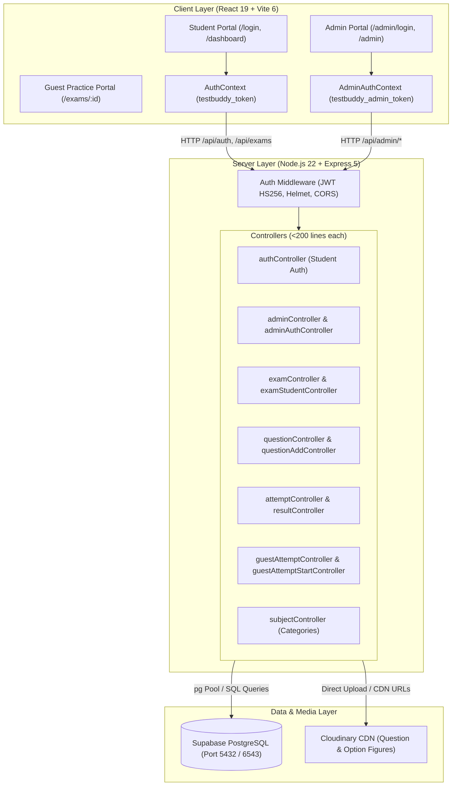

# TestBuddy 🎓

> A modern, lightweight, full-stack examination and assessment platform built with the PERN stack (PostgreSQL, Express 5, React 19, Node.js 22, Cloudinary, Vite 6).

---

## 🔑 Default Portal Credentials

The application uses **completely decoupled, isolated portals** for students and administrators:

| Portal | URL | Email | Password | Role |
|---|---|---|---|---|
| **Admin Console** | `http://localhost:5173/admin/login` | `admin@testbuddy.com` | `admin123` | `admin` |
| **Student Portal** | `http://localhost:5173/login` | `student@testbuddy.com` | `student123` | `student` |
| **Public Practice**| `http://localhost:5173/exams/:examId` | *No login needed* | *No password* | `guest` |

---

## 🏗️ Architecture Overview

TestBuddy is engineered with a modular, lightweight service architecture where **no single source file exceeds 200 lines of code**.



---

## 🔐 Decoupled Dual-Portal System

1. **Student Portal (`/login`)**:
   - Manages candidate identity with `AuthContext` and stores JWT in `testbuddy_token`.
   - On login, redirects directly to `/dashboard`.
   - Student session never grants access to administrative routes.
2. **Admin Portal (`/admin/login`)**:
   - Completely independent auth flow using `AdminAuthContext` with `testbuddy_admin_token`.
   - On login, navigates directly to `/admin` (no account switching dialogues).
   - Dedicated `<AdminLayout />` and `<AdminNavbar />` prevent unauthorized access or token leakage.
3. **Practice Guest Mode (`/exams/:examId`)**:
   - Open access for practicing students without registration.
   - Generates ephemeral session tokens in `sessionStorage`.
   - Individual answers are automatically purged upon grading to protect privacy.

---

## ☁️ Cloudinary Media Integration

Question prompts and multiple-choice options (A, B, C, D) support diagram uploads via Cloudinary:
- Uploads are organized into folder namespaces: `testbuddy/exams/:examId/`.
- Frontend receives direct HTTPS CDN URLs with native `loading="lazy"` and `decoding="async"`.
- Deleting a question or exam automatically triggers `cloudinary.uploader.destroy()` to remove orphaned files.

Configure your credentials in `backend/.env`:
```env
CLOUDINARY_CLOUD_NAME=your_cloud_name
CLOUDINARY_API_KEY=your_api_key
CLOUDINARY_API_SECRET=your_api_secret
```

---

## 🔑 Google OAuth 2.0 Integration

One-click sign-in and sign-up for students powered by Google Identity Services:
- Verified student account provisioning in PostgreSQL with `email_verified=true`.
- Issues standard TestBuddy session JWT (`testbuddy_token`).
- Fully decoupled: strictly isolated to student portal (`/login` & `/register`).

Configure your Google OAuth Client ID:
- **`backend/.env`**: `GOOGLE_CLIENT_ID=your-google-client-id.apps.googleusercontent.com`
- **`frontend/.env`**: `VITE_GOOGLE_CLIENT_ID=your-google-client-id.apps.googleusercontent.com`

---

## 🚀 Quick Start Guide

### Prerequisites
- [Node.js](https://nodejs.org/) (version 18.x or higher)
- [PostgreSQL](https://www.postgresql.org/) (or free Supabase project)
- [Cloudinary](https://cloudinary.com/) free account

### 1. Backend Setup
```bash
cd backend
npm install
# Ensure backend/.env has DATABASE_URL, JWT_SECRET, and Cloudinary keys
npm run dev
```
*Backend runs on `http://localhost:5000`.*

### 2. Frontend Setup
```bash
cd frontend
npm install
npm run dev
```
*Frontend opens on `http://localhost:5173`.*

---

## 📐 Core Engineering Invariants

- **Strict File Limit**: Every source file (JSX, JS, CSS) is strictly **fewer than 200 lines**.
- **Single Clock Authority**: Exam timers and auto-submissions rely solely on the database server clock (`NOW()`).
- **Route-Level Code Splitting**: All pages are dynamically lazy-loaded via `React.lazy()` and `<Suspense>`, keeping the initial bundle under 86 kB gzip.
- **Fail-Safe UI**: Wrapped in `<ErrorBoundary>` to ensure runtime errors render graceful recovery cards instead of blank screens.

---

## 📄 Owner
MD RAQUIF
